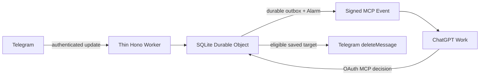

# Architecture decision — 2026-10-17

Status: implemented; production server deployed on Workers Free. External Telegram
and ChatGPT acceptance is tracked separately in [VERIFICATION](docs/VERIFICATION.md).

## Decision

Thin Hono Worker → SQLite-backed Durable Object → bounded Alarms. Compared with
Worker + Queues + DO, a transactional DO outbox avoids the database/queue dual-write
failure window and a separate consumer. Queues would add roughly three operations
per delivery, 24-hour Free retention and another reconciliation path. It is useful
for independent consumers and sustained bursts, which this single-bot MVP does not need.

One object per deployment owner/bot, with group_id on each row, is an intentional
simplification of one object per discussion group. It gives OAuth, subscriptions,
configuration and moderation one transactional authority; at most five allowed groups.
Group isolation is enforced in saved jobs and every action. Future sharding requires
an explicit migration. No D1, Drizzle, KV, R2, Redis, Workflows, Cron or Queue bindings.

Used starter: main commit 7b81c833ae99b40394a3b293dbddf2b3a22cfbc1, fetched
2026-10-17; README, AGENTS, package.json, wrangler.jsonc and Telegram module reviewed.
Retained Node/pnpm contract, Hono, TypeScript, Zod validation, feature boundaries,
RFC 9457 errors and the full verification gate. Removed Notes, OIDC, cookie sessions,
D1/Drizzle and their secrets, migrations and commands.

## Flow and authority

The outer Worker verifies routing, webhook secret/type and declared size, then
forwards the original request. It does not parse JSON, load the MCP SDK or wait
for model analysis. The DO enforces the streamed body limit, authenticates OAuth,
coordinates SQL and performs bounded external I/O. Worker CPU and DO CPU are
separate limits; deployment Startup Time is neither request CPU nor a cold probe.

SQLite stores updates, latest jobs, bounded root/parent context, decisions,
subscriptions, OAuth grants and work. Indexes cover due_at, job deadline, retention,
subscription expiry and filters. There is no independently authoritative queue.

## Durable acceptance and recovery

Every mutation first persists an Alarm watchdog, then uses synchronous SQLite
transaction semantics inside blockConcurrencyWhile. Admission atomically records
the update ID, message revision, old-work invalidation and delivery outbox. The
final indexed reschedule can move the alarm earlier/later or remove it when idle.
Telegram receives 2xx only after this completes; transient failure returns 503.
If SQL commits but final scheduling/ACK fails, the preexisting watchdog finds the
work, and a Telegram retry is deduplicated. Domain rejections are caught inside
blockConcurrencyWhile, so ordinary validation errors do not reset the object.

Alarms claim at most four operations per invocation. A claim persists in_flight,
attempt count and a 60-second lease before network I/O. A later alarm reclaims an
expired lease; built-in Alarm retries are an additional mechanism, not the only
recovery mechanism. At most five attempts, exponential backoff and Telegram
retry_after. No network I/O occurs within the SQL transaction or concurrency block.

| Boundary / failure | Durable result |
|---|---|
| Before SQL commit | No accepted job; Telegram retries |
| After commit, before final alarm/ACK | Watchdog plus update deduplication |
| After claim, before/after external call | Lease expiry discovers unfinished work |
| Event delivered but ACK/result lost | Same deterministic eventId on retry; duplicate may reach ChatGPT |
| Event 2xx | Delivery complete; moderation still pending |
| Delete succeeds but result write is lost | Retry may return missing; absence never proves this bot deleted it |
| Missing model decision / deadline | expired/review; comment remains |
| Exhausted attempts / permanent error | Finite error/missing/permission status; no endless retries |

## State and safe deletion

Jobs distinguish pending, protected, scope_unknown, review, allowed, would_delete,
awaiting_confirmation, deleting, deleted, missing, expired and error. Delivery
status is separate. Revisions use update identity, message identity, Telegram
edit date/update ordering and a content fingerprint. A substantive edit invalidates
old decisions and work. Unchanged duplicates do not create independent deletions.

Only a reply to a verified automatic channel root or a saved descendant proves
discussion ancestry. A reply can embed the root of an old post. Thread ID alone
does not prove scope. Saved group and channel IDs must still match the allowlist.
Roots, service messages, unknown senders, channel/group sender_chat identities and
explicit protected user/chat identities cannot be deleted. No history scraper,
getMessage fiction, attachment retrieval, OCR, link fetch, bans or replies.

The model supplies job ID, expected revision, verdict, reason and explanation.
Deletion targets come exclusively from saved jobs. Before each external delete,
the server rechecks revision, protection, mode/pause, config epoch, original
deadline and current can_delete_messages through getChatMember. Telegram cannot
atomically condition deletion on unchanged text: edits not yet delivered remain
an explicit race. Exactly-once external execution is not claimed.

dry_run writes would_delete without calling deletion. manual writes a recommendation;
an explicit owner command uses execute_reviewed_decisions. auto queues only a new,
eligible policy decision; enabling auto does not execute a backlog. Mode/pause
changes cancel retries. Unsubscribe cancels its deliveries, stops queued deletes
and conservatively returns the single-owner bot from auto to manual. Requests
already sent to Telegram cannot be cancelled retroactively.

Deadline defaults to 30 minutes per received revision, configurable 1 minute–6
hours, capped before Telegram's 48-hour deletion limit. Delivery never extends it.
An indexed deadline wakes the alarm even with an empty outbox. Text/updates/roots
expire after seven days; compact audit after 30. Cleanup is bounded to 25 rows per
table. Active subscription expiry also wakes an otherwise idle object; expired
keys are cleared, retired identities removed after seven days and capacity returned.

## MCP, access and callback transport

The official SDK 2.3.1 supplies stateless transport, tools and MCP 2.0
server/discover for 2026-07-28. Events are a draft extension absent from its method
registry, so a small adapter adds discovery capability and three Events methods.
The adapter checks matching version/method headers and namespaced request metadata.
Seven tools require owner OAuth; write tools advertise destructive effects.
Discovery/transport tests do not establish that a real ChatGPT host permits writes.

Owner consent uses a separate random login key, exact Origin and callback URI,
HttpOnly Secure one-time flow cookie, short-lived flow/code and PKCE S256.
Opaque bearer/code values are hashed in storage. Access expires in one hour,
refresh rotates and replay revokes the family. A closed redirect allowlist,
resource/client binding and bounded unauthenticated registration/login rates
limit access. This is a single-owner authorization server, not a general identity
provider. It does not implement Telegram OIDC or advertise OpenID discovery.

Subscriptions use Standard Webhooks HMAC over exact bytes, signed verification
challenge, stable delivery IDs, bounded TTL (24 hours maximum), idempotent refresh
and five-minute dual signatures on key rotation. There is no protocol replay:
cursor is null and pending jobs are the documented recovery path.

Callback egress requires an operator-verified exact hostname, HTTPS:443, no
userinfo/fragment/IP literal and no redirects. Each attempt performs a DNS A
preflight and rejects private/reserved answers. workerd resolve4 currently includes
CNAME data; aliases are never connection targets and all actual IPv4 are checked.

The actual HTTPS connection is made by Cloudflare's **public-only global fetch**,
with `global_fetch_strictly_public` explicitly enabled. This replaces the unusable
raw TCP socket transport to Cloudflare-fronted OpenAI callbacks. Actual destination
address validation is delegated to the runtime's public-network boundary, including
DNS changes between preflight and connection. TLS is verified for the original
URL hostname; no Host override, resolveOverride, origin binding or VPC binding is
used. Redirects are rejected before reading their response bodies. Timeout is
8 seconds across DNS, connection and body; streamed response bytes are capped at
64 KiB. This is a platform-specific transport, not a portable promise that an
arbitrary hostname fetch outside Cloudflare is safe.

Platform evidence: [strict public routing flag](https://developers.cloudflare.com/workers/configuration/compatibility-flags/#global-fetch-strictly-public),
[Cloudflare's SSRF explanation](https://blog.cloudflare.com/workers-environment-live-object-bindings/),
and the [runtime compatibility contract](https://github.com/cloudflare/workerd/blob/main/src/workerd/io/compatibility-date.capnp)
(`globalFetchStrictlyPublic`, public addresses only). The check gate rejects any
environment that removes strict public routing or enables private-origin routing.
Application DNS preflight is an additional check, not a claim that a separately
resolved address is manually pinned by fetch.

The public gateway preserves all previous secret, media type, size and Origin
rejections before any DO call. Its hot API routes bypass Hono routing and cache
only the immutable owner/bot DO ID per namespace. Every call gets a fresh stub;
a failed RPC does not poison later calls. The DO repeats HTTP validation before
parsing and persistence. Hono remains on health. No comment, auth response or
mutable moderation state is cached. CPU probes are authenticated, bounded and
outside the allowlist; first-request metadata identifies an isolate's first
invocation, not an overall guarantee of future CPU usage.

Live acceptance on 2026-10-17 confirmed both signed callback challenges, real
created/updated event delivery, unattended Work analysis and automatic deletion
of the owner's controlled spam sample. Real webhook CPU was 2–3 ms; two first
isolate requests measured 2 ms each. See docs/VERIFICATION.md for the exact sample
and remaining quota/renewal limits. Synthetic or mocked tests alone do not
establish these live results.

Technical logs contain only bounded error categories/paths. Invocation request
logging is disabled. Comments, OAuth query strings/codes, bot tokens, signing
secrets and full callback URLs are excluded. Secrets live in Worker bindings and
ignored local files. Incoming Telegram text is untrusted data; prompt injection
cannot supply arbitrary deletion targets or bypass server scope checks.
